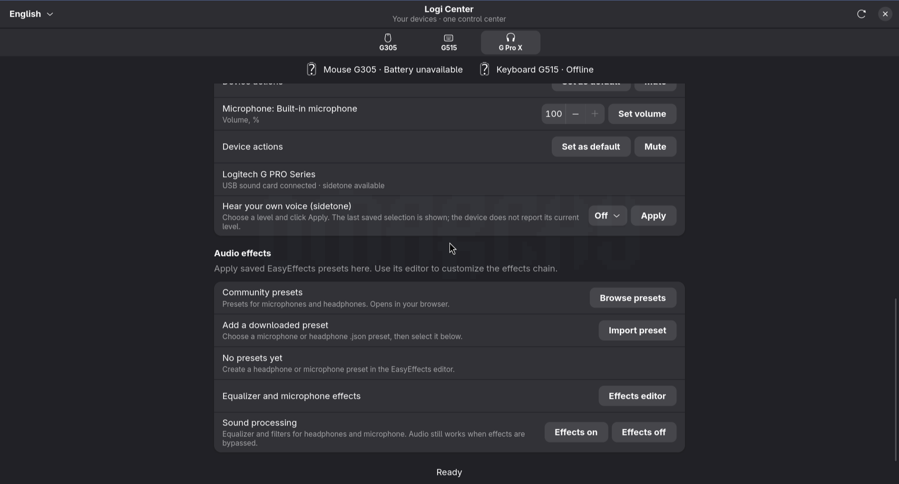
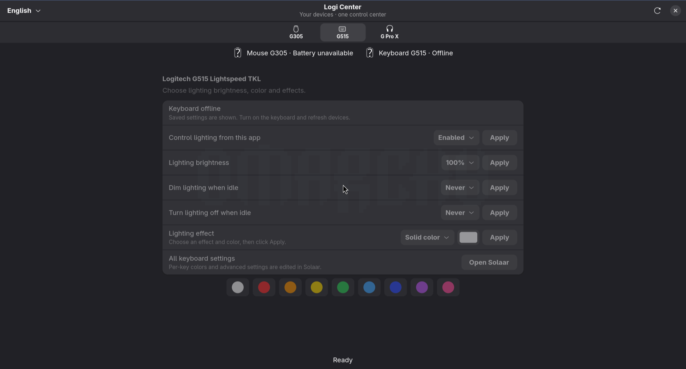

# Logi Center

A small Linux desktop control panel for Logitech G305, G515 LIGHTSPEED TKL and wired G PRO X headsets. Built with Python, GTK 4 and libadwaita, with Russian and English interfaces.

[Читать по-русски](README.ru.md)

Logi Center brings common controls into one window using existing Linux tools. It is an independent community project, not an official Logitech app or a complete G HUB replacement. It does not install a custom kernel driver.

## Preview





[Headset volume and microphone controls](docs/screenshots/audio-devices.png)

These are real application screenshots. The keyboard is offline, so its saved controls are shown disabled. No connected mouse or keyboard readings are simulated.

[Download the first preview release](https://github.com/Mirox921/logi-center/releases/tag/v0.1.0) · [Report a problem](https://github.com/Mirox921/logi-center/issues)

## Features

| Device / area | Controls |
| --- | --- |
| G305 mouse | DPI, polling rate, button assignments and common keyboard shortcuts through libratbag |
| G515 LIGHTSPEED TKL | Brightness, solid color, breathing, color cycle and lighting timers through Solaar |
| Wireless battery | G305 and G515 battery indicators, refreshed every 30 seconds; coarse levels remain coarse rather than invented percentages |
| G PRO X USB sound card | Output/microphone volume, mute and selection as the default audio device through PipeWire/PulseAudio |
| Sidetone | Supported HeadsetControl devices; last selected level is shown because live readback is not available through this interface |
| EasyEffects | Apply local presets, turn effects on/off, import input/output JSON presets and open the community preset catalog |
| Language | Switch Russian / English in the header; the choice is saved |

Piper, Solaar and EasyEffects editors can be opened for advanced settings. These editors are separate windows. Button mappings and lighting are applied only when you click **Apply**. Imported presets are saved under a new name when a matching name already exists.

## Requirements

Tested on Arch Linux with a Wayland desktop. Other distributions are not yet verified.

- Python 3, PyGObject, Pycairo, GTK 4 (4.10 or newer), libadwaita and PyYAML
- `libratbag` / `ratbagctl`, `piper`, `solaar`, `headsetcontrol`, `easyeffects`
- PipeWire with its PulseAudio compatibility service, `pactl`, `xdg-open`
- Device access using the udev rules supplied by the backend packages

On Arch Linux:

```sh
sudo pacman -S --needed python python-gobject python-cairo python-yaml gtk4 libadwaita \
  libratbag piper solaar headsetcontrol easyeffects pipewire-pulse libpulse xdg-utils
```

If some EasyEffects plugins are missing, install their dependencies as described in the [EasyEffects documentation](https://github.com/wwmm/easyeffects).

## Install and run

Clone the repository and run the user installer:

```sh
git clone https://github.com/Mirox921/logi-center.git
cd logi-center
python install.py
```

The installer copies the application to `~/.local/share/logi-center`, adds a launcher at `~/.local/bin/logi-center`, and creates a desktop menu entry. `XDG_DATA_HOME` is respected. No administrator access is needed for the app itself.

Open **Logi Center** from your application menu, or run:

```sh
~/.local/bin/logi-center
```

For development, run `python app.py` directly. Select **English** or **Русский** in the header. Run the installer again after pulling an update.

### Keyboard setup

Keyboard controls are built from settings already discovered and saved by Solaar. For a new G515 installation, initialize it in the Solaar GUI first and save the desired settings. Check the [Solaar documentation](https://pwr-solaar.github.io/Solaar/issues/) for RGB control conflicts: do not let several applications control the same lighting settings simultaneously.

At startup, Logi Center reads the saved settings and performs only a low-level HID++ ROOT ping to verify the keyboard connection. It does not run Solaar's full settings enumeration, which can invoke RGB shutdown cleanup in some builds. Explicit writes use a process-local adapter that suppresses that shutdown handler. The installed Solaar files are not modified.

### Ready-made audio presets

Open **G Pro X → Audio effects → Browse presets**, download an EasyEffects `.json` preset, then click **Import preset**. Select the imported preset and click **Apply**, then **Effects on**.

Input presets process microphone audio; output presets process headphone/speaker audio. **Effects off** bypasses EasyEffects processing without muting your devices. Presets requiring separate impulse-response or noise-model files need those resources installed using EasyEffects; the JSON importer does not bundle or download them.

## Saved settings

- Mouse values are read from the device; audio levels are read from the sound server.
- Keyboard preferences are read from `~/.config/solaar/config.yaml`.
- Language, last selected audio preset, lighting selection and sidetone selection are saved to `~/.config/logi-center/preferences.json` after successful actions.
- Import destinations: `~/.config/easyeffects/input` and `~/.config/easyeffects/output`.

Opening the app does not automatically replay sidetone or audio commands. A last saved selection is not proof of a device's current setting. Device reconnects and a full operating-system reboot have not been comprehensively tested. There is no automatic background service or login startup configuration.

## Current limitations

- No original Blue VO!CE or DTS engine, G HUB community integration, firmware updates or automatic per-game profiles.
- No integrated per-key RGB editor or audio effect-chain editor; use the external editors.
- G515 lighting writes and G PRO X sidetone need further physical testing across firmware versions.
- Controls target the listed hardware; other Logitech devices are not automatically supported.
- Battery connectivity is verified separately for G515; other battery readings depend on the kernel's reported state.

## Feedback

Hardware reports are welcome. Include your distribution, backend versions, device model and connection type, plus what you expected and what happened. Remove device serial numbers and personal paths from logs. For announcement text, see [community post drafts](docs/COMMUNITY_POSTS.md).

## Development and checks

```sh
python -m unittest -v
python -m py_compile app.py backend.py i18n.py solaar_write.py install.py
python app.py --smoke
```

`--smoke` opens the GUI, reads devices and closes after 12 seconds without applying settings. `--keyboard` and `--audio` select the initial tab. Hardware-dependent smoke checks require a running desktop session and device permissions.

## Uninstall

Delete `~/.local/share/logi-center`, `~/.local/bin/logi-center`, and `~/.local/share/applications/logi-center.desktop` (adjust the data paths if `XDG_DATA_HOME` is set). Optionally delete `~/.config/logi-center`. Device settings, Solaar settings and imported EasyEffects presets are left intact.

## Backends and license

- [libratbag](https://github.com/libratbag/libratbag) / [Piper](https://github.com/libratbag/piper)
- [Solaar](https://github.com/pwr-Solaar/Solaar)
- [HeadsetControl](https://github.com/Sapd/HeadsetControl)
- [EasyEffects](https://github.com/wwmm/easyeffects)

Logi Center's own code is distributed under the [MIT license](LICENSE). Backend tools are installed separately and retain their own licenses. Logitech and device names belong to their respective owners.
