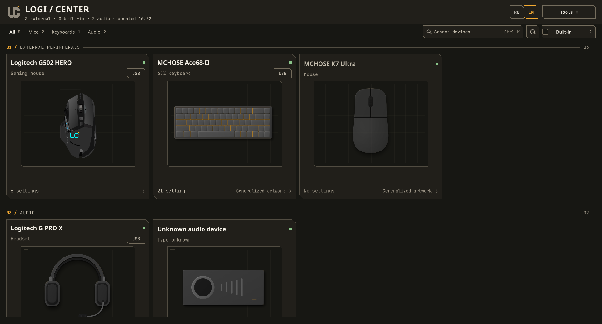
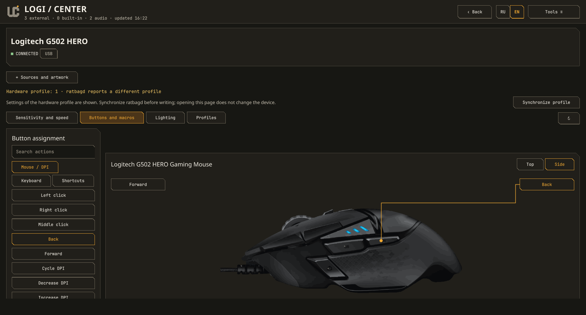
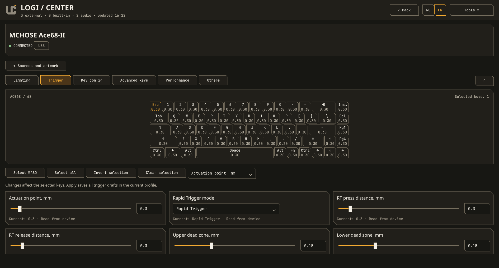
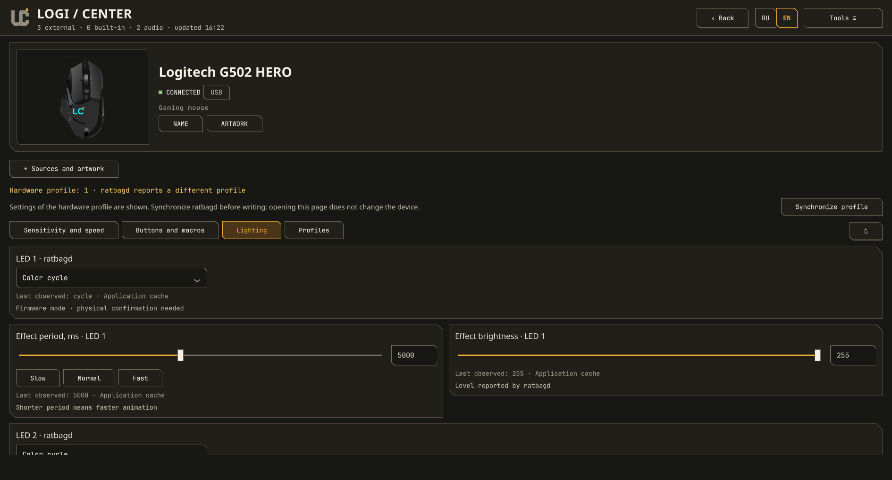
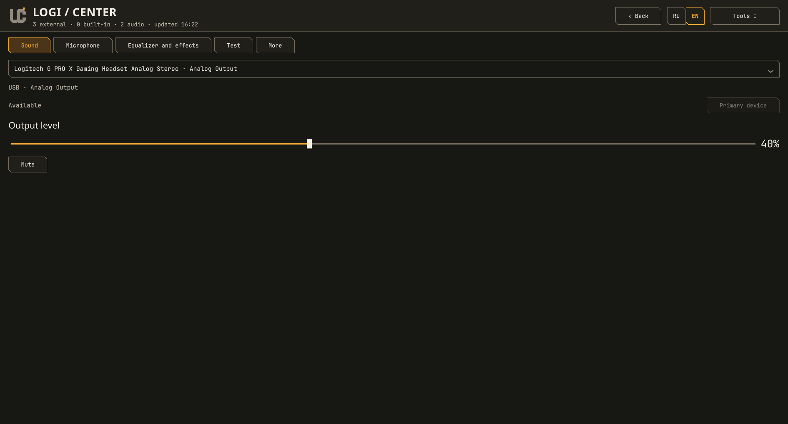

<p align="center">
  
</p>
<h1 align="center">LOGI / CENTER</h1>
<p align="center"><strong>A Qt6/QML control center for Linux peripherals.</strong><br>
Mice, keyboards and audio. One interface, existing Linux backends.</p>
<p align="center">
  <a href="https://github.com/Mirox921/logi-center/releases/latest"></a>
  <a href="https://github.com/Mirox921/logi-center/actions/workflows/checks.yml"></a>
  <a href="LICENSE"></a>
  <a href="https://github.com/Mirox921/logi-center/stargazers"></a>
</p>
<p align="center"><a href="README.ru.md">Русский</a> · <a href="https://github.com/Mirox921/logi-center/releases/tag/v0.5.1">Download v0.5.1</a> · <a href="docs/backend-support.md">Device support</a> · <a href="https://github.com/Mirox921/logi-center/issues">Report an issue</a></p>



## A new foundation

**Qt6/QML is now the only application interface.** Logi Center has moved from
GTK to a graphite-and-amber dashboard, interactive device editors and shared
Python services. `python app.py` and the installed application launcher open QML.
The previous GTK implementation remains in Git history; [cutover and recovery](docs/qml-cutover.md)
documents the archived baseline.

Logi Center is **not Logitech-only**. It brings existing Linux device services
and a small set of model-specific adapters into one place. Controls follow the
actual capabilities of the device, firmware and backend. It does not claim
universal support for a brand or recreate Windows-only features without a
working Linux implementation.

## Inside the app

<table>
<tr>
<td width="50%"><a href="docs/screenshots/releases/v0.5.1/mouse-side.png"></a><br><sub>Mouse buttons — accurate SVG artwork, selectable buttons and assignment drafts.</sub></td>
<td width="50%"><a href="docs/screenshots/releases/v0.5.1/keyboard.png"></a><br><sub>Keyboard — selectable keys and firmware-scoped actuation/Rapid Trigger controls.</sub></td>
</tr>
<tr>
<td width="50%"><a href="docs/screenshots/releases/v0.5.1/mouse-lighting.png"></a><br><sub>Lighting — native effects and effect-specific settings where supported.</sub></td>
<td width="50%"><a href="docs/screenshots/releases/v0.5.1/audio.png"></a><br><sub>Audio — server endpoints, defaults, volume, mute and optional effects.</sub></td>
</tr>
</table>

These are English screenshots of the real QML application, captured on
Hyprland/Wayland workspace 9 with live read-only device data. No hardware
settings were changed for the images. [Full gallery and capture details](docs/screenshots/README.md).
Warnings and unavailable values are genuine device/backend states.

## What you can do

- **Mice:** edit supported DPI stages, polling rates, onboard profiles, button
  assignments and lighting. G502 has shared top/side SVGs and all 11 native button IDs.
- **Keyboards:** select keys and edit supported layouts, RGB and per-key settings.
  Ace68-II functions are gated to the implemented firmware protocol; G515 uses Solaar.
- **RGB:** prefer native firmware effects, with zones, period and brightness
  where the provider exposes them. No silent host-side animation loop.
- **Macros:** record keys, clicks and delays in a separate capture window and
  keep a private reusable library. Device upload remains capability-specific.
- **Audio:** choose outputs/inputs, set defaults, adjust volume/mute and use
  explicit microphone tests or EasyEffects presets. Recording starts only on request.
- **Data:** edit drafts before Apply, preview/select backup fields, restore with
  a private safety snapshot and export redacted diagnostics.
- **Preferences:** English/Russian, reduced motion, custom device names/artwork
  and QML scaling from 75–200% after restart.

Hardware work runs outside the GUI thread. Commands are serialized and guarded
against disconnection, stale state and profile changes. Sent, cached, verified,
unverified and failed results remain distinct. Shared services and existing
backup formats are retained.

## Device support and evidence

| Device / backend | Available integration | Verification boundary |
|---|---|---|
| **Logitech G502 HERO / libratbag** | DPI, polling, profiles, buttons/macros, two reported lighting zones | User verified LED 1 Color Cycle at 8000 ms / brightness 255 continues after closing the app. Other effects/zones are not all physically verified. [RGB report](docs/g502-rgb.md) |
| **MCHOSE K7 Ultra** | DPI/buttons/sensor panels, charging indicators and native dock RGB | Selected reversible tests and dock observations are recorded individually. A receiver may be present while the sleeping mouse does not answer; the app does not invent values. [Controls](docs/k7-controls.md), [dock](docs/k7-dock-rgb.md) |
| **MCHOSE Ace68-II, firmware 121** | Key selection, actuation/RT/dead zones, native effects, key maps and supported advanced banks | Earlier selected writes/readbacks were physically tested; many newer bank/per-key paths are mock-tested only. No unverified firmware/calibration operations. [Editor](docs/ace68-editor.md) |
| **Logitech G515 LS TKL / Solaar** | Scoped settings, native RGB, brightness/timers and available per-key data | Live settings take precedence; RGB control Off does not make the device unavailable. No complete G HUB parity claim. [G515](docs/g515-settings-fix.md) |
| **EWEADN S9 family** | Model-verified DPI, polling/performance/sensor controls, button editor and supplied SVG | Protocol/source and mock validation; no physical S9 confirmation here. Native macro-bank upload is disabled pending safe read/rollback. [S9](docs/eweadn-s9.md) |
| **Other providers** | OpenRGB, OpenRazer, rivalcfg, HeadsetControl, PipeWire/PulseAudio and Linux input | Runtime capability-driven subsets; ckb-next is discovery-only. Exact model support follows each provider. [Backend matrix](docs/backend-support.md) |

**Implemented, mock-tested and physically verified are different states.**
Unknown devices retain generic Linux input and honest unavailable controls.
See the [action-level matrix](docs/qml-parity.md) for remaining limits.

## Download and run

Download the source archive or Arch package from [v0.5.1](https://github.com/Mirox921/logi-center/releases/tag/v0.5.1).
Check `SHA256SUMS` before using the release assets. This is a Python/Qt application,
not a self-contained AppImage; the runtime dependencies must be installed.

Arch Linux runtime:

```sh
sudo pacman -S --needed python python-yaml python-gobject pyside6 qt6-declarative qt6-svg qt6-wayland
```

Run the extracted source folder:

```sh
python app.py
# Isolated demo — no real hardware operations:
python app.py --simulate
```

Or clone a lightweight current checkout and install for your user:

```sh
git clone --depth 1 https://github.com/Mirox921/logi-center.git
cd logi-center
python install.py
logi-center
```

The installer updates `~/.local/share/logi-center`, `~/.local/bin/logi-center`
and the application-menu entry. **After pulling source updates, rerun the
installer** to update the menu-launched copy. User preferences, drafts and
backups are preserved. No root is needed for this installer.

Vendor backends are optional and installed separately: for example, libratbag
for compatible mice, Solaar for supported Logitech devices and HeadsetControl
for headset features. Do not run the entire GUI as root to bypass HID access.
[Launch guide](START_HERE.ru.md) · [Local Arch build](packaging/arch/README.md).

## Development and repository policy

Source code uses `src/logi_center`, shared assets live in `assets`, and tests are
split into `unit`, `integration` and mocked `hardware` contracts. See the
[repository architecture and package workflow](docs/development/architecture.md).

```sh
python scripts/check.py            # unit tests and compilation
python scripts/gui_smoke.py        # QML loading, navigation and qmllint
python scripts/simulation_smoke.py # real service paths, mock hardware I/O
```

Developer artwork tools also need PyCairo. CI additionally covers model editors,
backups, localization, SVG rendering and reconnect/readback guards. Automated
checks do not replace physical device validation.

The repository keeps application code, assets and licenses, tests/fixtures,
protocol evidence and a small release gallery. Generated captures, local agent
files, caches and built packages stay out of Git. Historical review screenshots
are archived locally, and prior published releases remain in Git history. [Screenshot policy](docs/screenshots/README.md).

## License and feedback

Logi Center is MIT licensed. Qt, fonts, artwork and backend projects retain
applicable notices and licenses. See bundled `SOURCES.md` and license files.
When reporting a device issue, include its model, firmware/backend version and
a redacted diagnostic report. Do not publish serials, private macros, raw HID
buffers or user configuration files.
