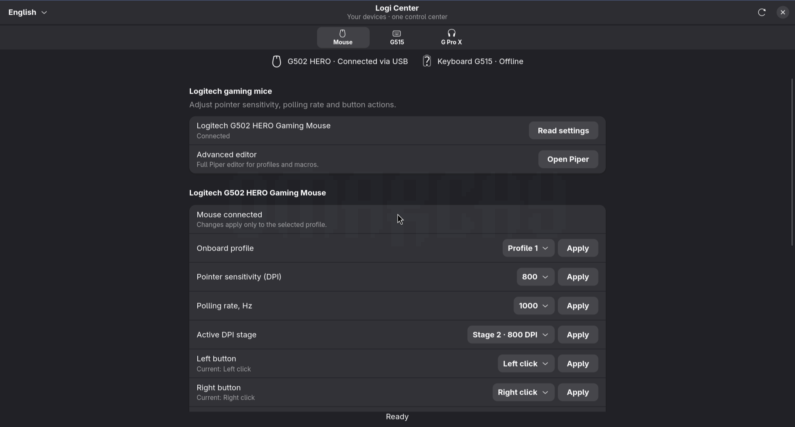

# Logi Center

Единое приложение Linux для Logitech G305, G502 HERO, G515 LIGHTSPEED TKL и проводных G PRO X с USB-звуковой картой. Интерфейс на русском и английском; язык выбирается в заголовке окна и сохраняется.

[English documentation](README.md)

Это независимый проект сообщества. Он объединяет существующие инструменты Linux, не является официальной программой Logitech, новым драйвером ядра или полной заменой G HUB.

## Скриншоты



[Подсветка и дополнительные кнопки G502 HERO](docs/screenshots/g502-lighting.png)


[Громкость наушников и микрофона](docs/screenshots/audio-devices.png) · [Сохранённые настройки подсветки отключённой клавиатуры](docs/screenshots/keyboard.png)

Это реальные снимки приложения. Клавиатура отключена, поэтому её сохранённые настройки недоступны для изменения. На снимках мыши подключена настоящая G502 HERO; показания устройств не имитируются.

[Скачать текущую версию](https://github.com/Mirox921/logi-center/releases/tag/v0.2.0) · [Сообщить об ошибке](https://github.com/Mirox921/logi-center/issues)

## Возможности

- **G305 / G502 HERO:** DPI активного профиля, частота опроса и назначения кнопок. Для G502 добавлены 5 встроенных профилей, 11 кнопок и 2 зоны подсветки. Чтение проверено на подключённой G502; применение изменений требует дальнейшей проверки. Цвет в сохранённом профиле может отличаться от видимого на мыши.
- **G515:** яркость, визуальный выбор цвета, постоянная подсветка, дыхание, цикл цветов и таймеры.
- **Батареи:** заряд G305 и G515 с обновлением каждые 30 секунд. Если устройство сообщает только уровень, точный процент не выдумывается.
- **G PRO X:** громкость наушников и микрофона, выключение звука, выбор устройства по умолчанию; sidetone через HeadsetControl при наличии поддержки.
- **EasyEffects:** выбор сохранённых пресетов, включение и обход обработки, импорт файлов `.json`, переход к каталогу готовых эффектов.
- Дополнительные редакторы Piper, Solaar и EasyEffects открываются отдельными окнами.

## Улучшения надёжности в рабочей версии

- Результат записи различает подтверждение, отправку без подтверждения, несовпадение, ошибку, отключение и отмену. Данные G502 из libratbag помечены как кэш backend: это не подтверждение видимого цвета RGB.
- Резервные копии JSON содержат версию, модель, источник данных и контрольную сумму. Перед восстановлением доступны предпросмотр и выбор категорий; сохраняется защитная копия. При первой ошибке процесс останавливается с отчётом о частичном применении. Это копия поддерживаемых полей, не всей памяти устройства. Для G515 источник — сохранённые настройки Solaar.
- Подключение и отключение отслеживаются автоматически. Доступность управления обновляется, устаревшие операции отменяются. При отсутствии необязательного `pyudev` используется проверка sysfs раз в пять секунд.
- Добавлена схема мыши с выбором кнопки, черновиками назначений, записью клавиш и редактированием макросов при подтверждённой поддержке backend.
- Пресеты микрофона и наушников разделены. Индикатор уровня и запись до восьми секунд запускаются только кнопками. Обработанный образец доступен при обнаруженном реальном маршруте EasyEffects. Временные записи удаляются при обновлении, отключении, закрытии или явном удалении.
- Кнопка диагностики в заголовке показывает состояние компонентов и понятные причины ошибок. Ограниченные по размеру журналы не содержат назначений кнопок и макросов.

Архив v0.2.0 и старые скриншоты ещё не содержат эти изменения. [Проверки и ограничения](docs/reliability-upgrade.md).

## Установка

Поддержка G502 HERO включена в v0.2.0. Скачай текущий архив релиза, распакуй и выполни `python install.py` либо обнови клонированный репозиторий и повтори установку.

Проверено на Arch Linux с Wayland. Другие дистрибутивы пока не проверены.

```sh
sudo pacman -S --needed python python-gobject python-cairo python-yaml gtk4 libadwaita \
  libratbag piper solaar headsetcontrol easyeffects pipewire-pulse libpulse xdg-utils
```

В каталоге скачанного проекта:

```sh
python install.py
```

Открой **Logi Center** через меню приложений или выполни `~/.local/bin/logi-center`. Для запуска из исходников: `python app.py`. После обновления проекта повтори установку.

Установщик работает от обычного пользователя. Файлы приложения находятся в `~/.local/share/logi-center`, ярлык — в меню приложений. Переменная `XDG_DATA_HOME` учитывается.

## Первое подключение клавиатуры

Для новой G515 сначала открой Solaar, чтобы он обнаружил и сохранил доступные настройки. Logi Center использует этот сохранённый список. Не давай нескольким программам одновременно управлять одной подсветкой.

При запуске Logi Center не запрашивает полный список аппаратных настроек через Solaar: в некоторых сборках завершение такого запроса вызывает анимацию выключения RGB. Связь проверяется отдельным запросом HID++ без команд управления подсветкой. Для явной записи используется локальный адаптер; установленный Solaar не изменяется.

## Как импортировать эффекты

1. Открой **G Pro X → Обработка звука → Найти готовые эффекты**.
2. Скачай пресет EasyEffects в формате `.json`.
3. Нажми **Импортировать эффект** и выбери файл.
4. Выбери его в списке, нажми **Применить**, затем **С эффектами**.

**Без эффектов** пропускает звук без обработки, но не отключает наушники и микрофон. Пресеты микрофона и наушников различаются. Если пресету нужны отдельные файлы импульсного отклика или модели шумоподавления, их следует добавить в EasyEffects отдельно.

## Сохранение

DPI и кнопки сообщает libratbag, причём значения могут быть кэшированы; громкость — из звуковой системы, параметры клавиатуры — из `~/.config/solaar/config.yaml`. Язык и последние выбранные пресет, подсветка и sidetone сохраняются в `~/.config/logi-center/preferences.json` после успешного применения.

Sidetone при запуске автоматически не применяется: показанный последний выбор не является чтением текущего значения с устройства. Автозапуска в фоне нет. Переподключение устройств и полная перезагрузка ОС ещё не проверены во всех сценариях.

## Ограничения

Нет оригинальных Blue VO!CE/DTS, обновления прошивок, скачивания эффектов из G HUB и автоматических игровых профилей. Поклавишные цвета и цепочки звуковых эффектов редактируются во внешних программах. Запись RGB и sidetone требует дополнительной проверки на разных версиях прошивок. Другие модели Logitech автоматически не поддерживаются.

## Проверка и удаление

Проверки: `python scripts/check.py`. Диагностика без записи звука: `python scripts/diagnose.py`. Проверка виджетов: `python scripts/gui_smoke.py`. Проверка окна без применения настроек: `python app.py --smoke`.

Чтобы удалить приложение, удали `~/.local/share/logi-center`, `~/.local/bin/logi-center` и `~/.local/share/applications/logi-center.desktop`. При необходимости удали `~/.config/logi-center`. Настройки устройств и импортированные пресеты останутся.

Подробности, список компонентов и лицензия: [README.md](README.md). Код Logi Center распространяется под [MIT](LICENSE); внешние инструменты сохраняют свои лицензии.
