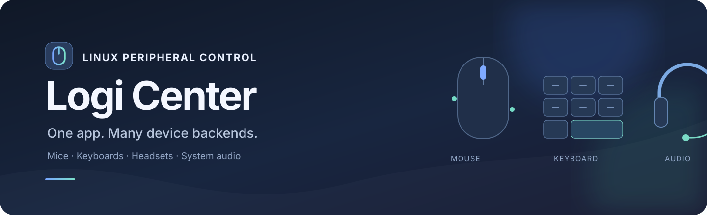
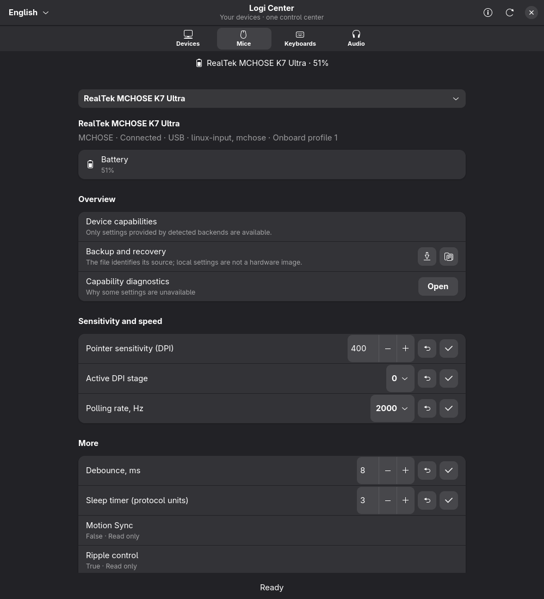
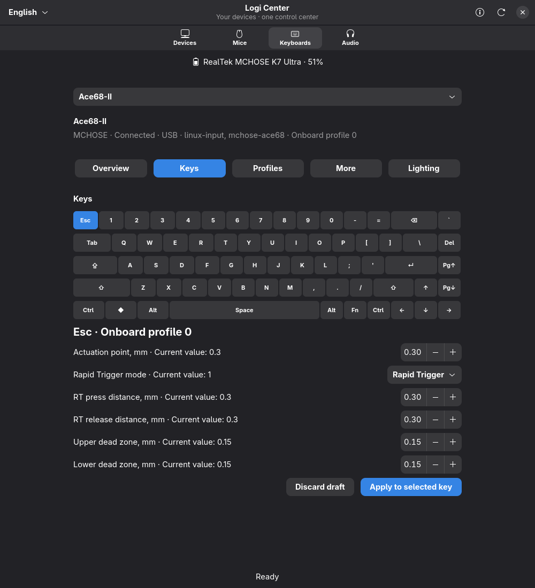
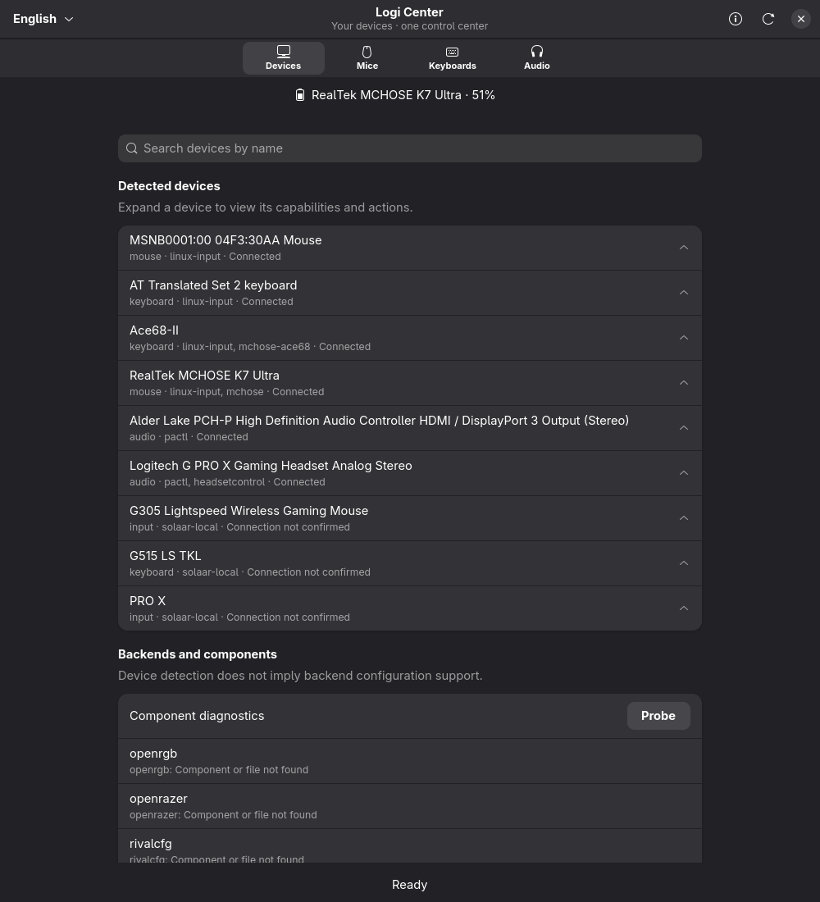
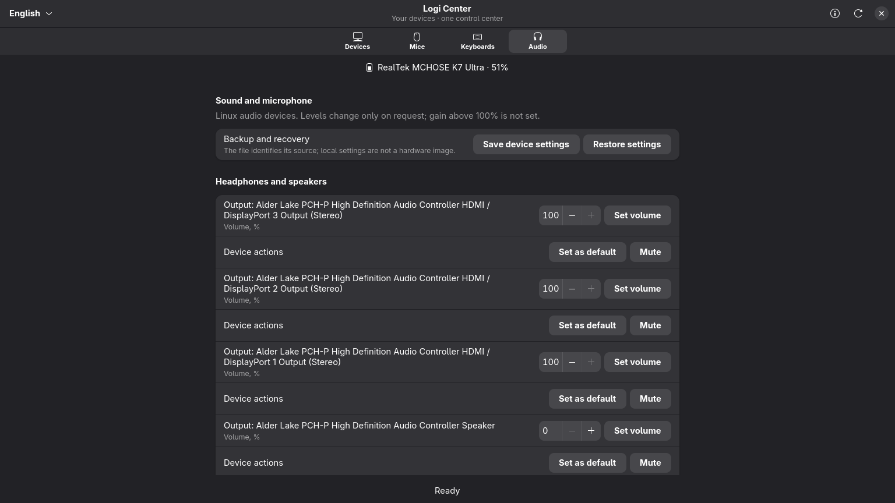

<p align="center">
  
</p>

<p align="center">
  <a href="https://github.com/Mirox921/logi-center/releases/latest"></a>
  <a href="https://github.com/Mirox921/logi-center/stargazers"></a>
  <a href="https://github.com/Mirox921/logi-center/releases"></a>
  <a href="LICENSE"></a>
</p>

<p align="center"><b>Одно приложение Linux. Много backend для периферии.</b><br>
Управление мышами, клавиатурами и звуком в GTK4/libadwaita.<br>
<a href="README.md">English version</a> · <a href="https://github.com/Mirox921/logi-center/releases/latest">Скачать</a> · <a href="https://github.com/Mirox921/logi-center/issues">Сообщить о проблеме</a></p>

> **Logi Center теперь не только для Logitech.** Приложение объединяет возможности Linux-сервисов и открытых backend для разных производителей. Доступные функции зависят от конкретной модели, прошивки, установленного backend и прав доступа. Поддержка устройства в стороннем проекте не означает, что Logi Center управляет всеми моделями этого производителя.

## Кратко о проекте

| | |
|---|---|
| **Категории** | Мыши · клавиатуры · гарнитуры и системный звук |
| **Проверено на реальном оборудовании** | Мышь MCHOSE K7 Ultra · клавиатура MCHOSE Ace68-II · Logitech G502 HERO — чтение и резервная копия |
| **Backend** | libratbag, Solaar, адаптеры MCHOSE, OpenRGB, OpenRazer, rivalcfg, ckb-next, HeadsetControl, PipeWire/PulseAudio и Linux input/udev |
| **Рабочий стол** | GTK 4.10+ · libadwaita · Python · русский и английский интерфейс |
| **Лицензия** | MIT для Logi Center; сторонние backend сохраняют свои лицензии |

## Как выглядит приложение

<table>
  <tr>
    <td width="50%"><a href="docs/screenshots/current-mouse.png"></a><br><sub>Мыши — элементы управления строятся по возможностям устройства и backend.</sub></td>
    <td width="50%"><a href="docs/screenshots/current-keyboard.png"></a><br><sub>Клавиатуры — выбор клавиши и поддерживаемые настройки срабатывания.</sub></td>
  </tr>
  <tr>
    <td width="50%"><a href="docs/screenshots/current-devices.png"></a><br><sub>Устройства — список подключённой периферии и диагностика backend.</sub></td>
    <td width="50%"><a href="docs/screenshots/current-audio.png"></a><br><sub>Аудио — полноэкранный раздел; интерфейс на снимке показан на английском.</sub></td>
  </tr>
</table>

Это реальные снимки GTK-приложения. Заряд K7 на снимке получен от устройства во время просмотра. Схема Ace68-II соответствует проверенной раскладке; она не означает, что каждая клавиша поддерживает все возможные функции.

## Что работает и насколько это проверено

### Проверено на реальном оборудовании

| Устройство | Что проверено в этом проекте | Что пока не подтверждено |
|---|---|---|
| **MCHOSE K7 Ultra** · USB `3837:1001` | Чтение идентификатора и конфигурации, DPI и ступеней, polling rate, профиля и доступных флагов, debounce/sleep, батареи. DPI изменён `400 → 450 → 400` и подтверждён повторным чтением; исходная конфигурация восстановлена. Мышь отображается во вкладке «Мыши», заряд берётся из backend. | Другие ревизии MCHOSE; запись ступеней DPI, polling rate, профиля и debounce/sleep; LOD; RGB через протокол мыши; кнопки/макросы; индикатор зарядки на физически подключённой мыши. |
| **MCHOSE Ace68-II** · USB `41e4:2116`, код прошивки `121` | Активный профиль, яркость, палитра/цвет/эффект/скорость RGB, polling rate, точка срабатывания выбранной клавиши, режим Rapid Trigger, пороги нажатия/отпускания, dead zone и переключение профиля. Обратимые изменения прочитаны и восстановлены. Проверено выборочное восстановление из резервной копии. | Другие ревизии/прошивки Ace68, сохранение после выключения питания, резервная копия всех профилей, RGB отдельных клавиш, SOCD/Snap Tap, DKS, Mod Tap, Toggle Key, переназначение и макросы. |
| **Logitech G502 HERO** · USB `046d:c08b` | Физическое чтение: 5 профилей, 11 кнопок, 2 зоны подсветки; проверены JSON-копия и предпросмотр. | Физическая проверка записи настроек и видимой подсветки. Значения libratbag могут быть кэшем демона и не подтверждают фактический цвет. |

Аппаратная проверка заявлена только для этих тестов. Обозначение Ace68-II относится к обнаруженной ревизии с указанным USB-идентификатором и не подтверждает совместимость всех товаров с названием «Ace 68».

### Интеграции backend

| Backend | Что приложение использует | Проверка и ограничения |
|---|---|---|
| **libratbag / ratbagd** | DPI, polling rate, профили, кнопки/макросы и подсветка, сообщаемые для мыши | Существующий общий адаптер; доступность зависит от точной модели в базе ratbag. Значения могут быть кэшем демона. |
| **Solaar** | Список сохранённых Logitech-устройств и явные запросы поддерживаемых настроек | Используются поддерживаемые Solaar устройства и параметры. История сохранённых устройств не доказывает текущее подключение. |
| **MCHOSE** | Отдельные адаптеры мыши K7 и клавиатуры Ace68-II | Ограниченные документированным протоколом функции; аппаратные тесты перечислены выше и относятся только к указанным устройствам. |
| **OpenRGB SDK** | Поиск локальных RGB-устройств/зон/режимов, цвет и доступная яркость | Подключение к SDK-серверу на loopback. Приложение не запускает сервер и не открывает его наружу. Кэш сервера — не доказательство видимого цвета. |
| **OpenRazer** | Возможности установленного API: например, поддерживаемые DPI/polling/яркость/заряд | Нужны собственные драйвер и демон. Отображаются только обнаруженные функции; происхождение кэшированных значений сохранено. |
| **rivalcfg** | Точные поддерживаемые HID-профили SteelSeries и ограниченный набор параметров | В основном запись без readback; приложение не выдумывает текущее значение и эффекты. |
| **ckb-next** | Метаданные Corsair-устройств и обнаруженные функции | Только обнаружение; запись профилей и подсветки через ckb-next пока не интегрирована. |
| **HeadsetControl** | Заряд и sidetone для устройств, где это поддерживает установленная версия | Совместимость определяется точной моделью в HeadsetControl. |
| **PipeWire / PulseAudio** | Системный выбор аудиоустройств, громкость, mute и явные тесты микрофона | Это управление аудиосервером, а не подтверждение настроек прошивки/DSP гарнитуры. EasyEffects обрабатывает звук программно. |
| **Linux input / udev** | Текущее подключение мышей/клавиатур и события hotplug | Обнаружение стандартного ввода само по себе не добавляет фирменные настройки. |

Подробности: [совместимость backend, зависимости и ограничения](docs/backend-support.md) и [отчёт о тестах MCHOSE](docs/mchose-devices-progress.md). Проект **не заявляет универсальную поддержку Logitech, Razer, Corsair, SteelSeries или других брендов**.

## Что нового в v0.4.0

- Перестроено описание и управление вокруг физических категорий устройств и обнаруженных возможностей, а не только Logitech.
- Добавлены независимые адаптеры мыши MCHOSE K7 Ultra и клавиатуры Ace68-II, использующие общий путь capabilities и резервного копирования.
- Добавлено обнаружение возможностей OpenRGB, OpenRazer, rivalcfg и ckb-next наряду с libratbag, Solaar, HeadsetControl, Linux audio/input.
- Подключённые мыши и клавиатуры направляются в свои разделы; сохранённая история и симуляции отделены от активных устройств; осторожное сопоставление не объединяет модели только по названию.
- Добавлены источник и состояние данных, статусы зарядки, компактные раскрываемые карточки диагностики, поиск по имени и обновлённые разделы мышей/клавиатур.
- Расширены тесты без оборудования, GTK smoke-проверки, сценарии симуляции и инструкции для Arch.

Подробности: [заметки к v0.4.0](docs/RELEASE-v0.4.0.md), [прогресс разработки](docs/implementation-progress.md), [проверка категорий и интерфейса](docs/category-ui-progress.md).

## Скачать и установить

**Последняя стабильная версия: [v0.4.0](https://github.com/Mirox921/logi-center/releases/tag/v0.4.0).** На странице релиза будут исходный архив и файлы для скачивания. Для сборки локального пакета Arch Linux см. [инструкцию](packaging/arch/README.md).

Установка для текущего пользователя из исходников:

```sh
git clone https://github.com/Mirox921/logi-center.git
cd logi-center
python install.py
```

Программа устанавливается в `~/.local/share/logi-center`, запускается через `~/.local/bin/logi-center` и появляется в меню приложений. Права администратора приложению не нужны. Ставьте только используемые backend: Logi Center не устанавливает системные службы, драйверы, группы и udev-правила автоматически.

### Базовые зависимости рабочего стола (Arch Linux)

```sh
sudo pacman -S --needed python python-gobject python-cairo python-yaml gtk4 libadwaita
```

Backend устанавливаются отдельно и нужны только для соответствующих моделей. См. [список зависимостей Arch](packaging/arch/PKGBUILD) и [заметки настройки backend](docs/backend-support.md). Не запускайте всё приложение от root для обхода ограничений доступа к устройствам.

## Безопасность и данные

- Для значений указывается источник: устройство, кэш backend, локальная настройка или черновик. Запись без readback не обозначается как подтверждённая устройством.
- Резервная копия содержит поддерживаемые поля, а не всю прошивку или память устройства. Перед восстановлением можно посмотреть и выбрать поля; не каждый backend способен автоматически отменить частичное восстановление.
- Диагностика экспортируется только по запросу и обезличивается; автоматической отправки нет. Содержимое макросов и серийные номера не включаются по умолчанию.
- Прошивка, заводской сброс, непроверенные HID-команды и автоматическая установка backend не выполняются.
- OpenRGB использует локальный SDK адрес; если он нужен, пользователь сам запускает и настраивает сервер.

## Проверки и симуляция

```sh
python -m unittest -q
python scripts/check.py
python scripts/gui_smoke.py
python scripts/simulation_smoke.py
python app.py --simulate
```

Автотесты и симуляция не заменяют испытания на реальном оборудовании. Перечень фактических аппаратных проверок приведён выше и в отчёте устройства. Для сборки пакета Arch без установки следуйте [инструкции](packaging/arch/README.md).

## Известные ограничения

- Набор функций зависит от backend и ревизии устройства; неизвестная модель может отображаться только как стандартное устройство ввода или в диагностике.
- Некоторые backend возвращают кэш или предоставляют только запись. Такие результаты обозначаются честно и не считаются аппаратным readback.
- ckb-next пока используется только для обнаружения. Интеграции OpenRGB, OpenRazer и rivalcfg не являются физической сертификацией всех упомянутых моделей.
- Редактирование SOCD/Snap Tap, DKS, Mod Tap, Toggle Key, переназначений и макросов Ace68-II недоступно: безопасный формат записи не подтверждён.
- Режим сна Bluetooth, расширенные проверки отключения/подключения, чистая установка и сохранение настроек после выключения питания требуют дополнительных проверок.

## Разработка и обратная связь

Предложения и pull request приветствуются. Для нового устройства укажите модель, подключение, backend/версию и обнаруженные функции; можно приложить обезличенный диагностический отчёт. Не публикуйте серийные номера, личные пути, приватные макросы и необработанные конфигурации. Процесс разработки описан в [`AGENTS.md`](AGENTS.md).

## Лицензия

Logi Center распространяется по MIT. Сторонние backend и названия устройств принадлежат соответствующим проектам и владельцам товарных знаков.
