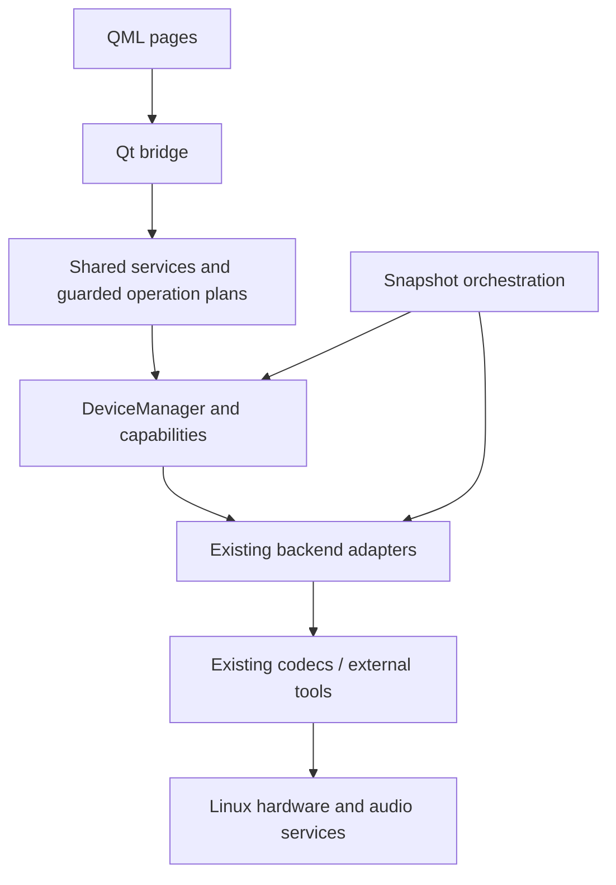

# Repository architecture

Production Python code lives in `src/logi_center`. Source assets live in `assets`;
they are copied unchanged into `logi_center/assets` for wheels, Arch packages and
the user-local installation. `resources.py` resolves both layouts and supplies
absolute URLs to QML. Qt never depends on the current working directory.

```text
src/logi_center/
  cli.py, __main__.py       CLI and QML launch
  core/
    devices/               Device, DeviceManager, shared editor/presentation models
    discovery/             snapshots, monitors, Epoch, private physical identity
    capabilities/          backend-independent Capability observations
    services/              executor, plans/readback, drafts, backups, audio, reports
  adapters/
    logitech/              libratbag, scoped Solaar, G515 and HID++ status
    mchose/                K7 and Ace68 adapters/settings
    eweadn/                S9 adapter
    external/              Linux input/power, PulseAudio, HeadsetControl,
                           optional SDK adapters and existing CLI boundary
  protocols/               Ace68 and EWEADN codecs
  qml_ui/                  Qt bridge, QML pages and Theme
assets/
  mice/                    exact SVGs, model metadata and interactive diagrams
  keyboards/               existing keyboard fallback SVGs
  icons/                   shared interface icons and source notices
  fonts/                   bundled fonts and licenses
  devices/                 shared generated class artwork and generic fallbacks
scripts/artwork/           offline Cairo renderer; excluded from runtime packages
tests/
  unit/                    codecs, plans, capabilities and pure state tests
  integration/             bridge, editor, packaging and artwork scenarios
  hardware/                mocked contracts for explicitly invoked trial scripts
```



`DeviceManager` remains the single inventory/identity and RGB-routing authority.
Adapters construct real observations; services retain existing serialization,
cancellation, generation checks, drafts and readback semantics. This relocation
does not certify additional hardware features or change stored data formats.
`core/devices/devices.py` keeps Device/DeviceManager; platform discovery and
libratbag/Pulse/HeadsetControl/Solaar adapters have their own adapter modules.
The current MCHOSE transport remains with its adapter: splitting its mature
transport implementation further is unnecessary for this repository migration.

## Launch and development

From a checkout, `python app.py [--simulate]` remains supported without a package
installation. `python install.py` installs the package/assets for the current user
without importing Qt or installing dependencies. Existing private preferences,
macros, drafts, device images and backups are preserved.

A standard wheel supplies `logi-center` and `python -m logi_center`:

```sh
python -m pip install .
logi-center --version
python -m logi_center --simulate
```

System backend dependencies (including PyGObject for D-Bus readers) are documented
in the main README. Cairo is needed only for developer artwork tests/tools.

```sh
python -m unittest -q                    # recursively discovers all three test groups
python scripts/check.py                 # compilation and hardware-free tests
python scripts/gui_smoke.py              # qmllint and isolated QML navigation
python scripts/simulation_smoke.py       # fake device commands, no physical writes
python -m scripts.artwork.illustrations.checks
python -m build                         # wheel and source distribution
python scripts/check_package.py dist/logi_center-0.5.1-py3-none-any.whl
python scripts/prepare-arch.py /tmp/logi-arch-new
```

Developer scripts and tests bootstrap only the checkout's `src` directory.
Production imports are fully qualified; no flat-module compatibility aliases or
second copies of the hardware services exist. The root `app.py` is the sole
legacy launch shim. `_worker.py` resolves its own package directory so bounded
SDK/Solaar subprocesses also work outside the checkout and without PYTHONPATH.

The source archive manifest is `scripts/source_manifest.py`; it includes source,
tests/fixtures, packaging, text documentation and the curated release gallery.
Ignored screenshots, reference photos, caches and private files are excluded.
Wheels contain only `logi_center`, its QML/assets and distribution metadata.

No real HID writes, profile changes or audio recordings are part of these checks.
